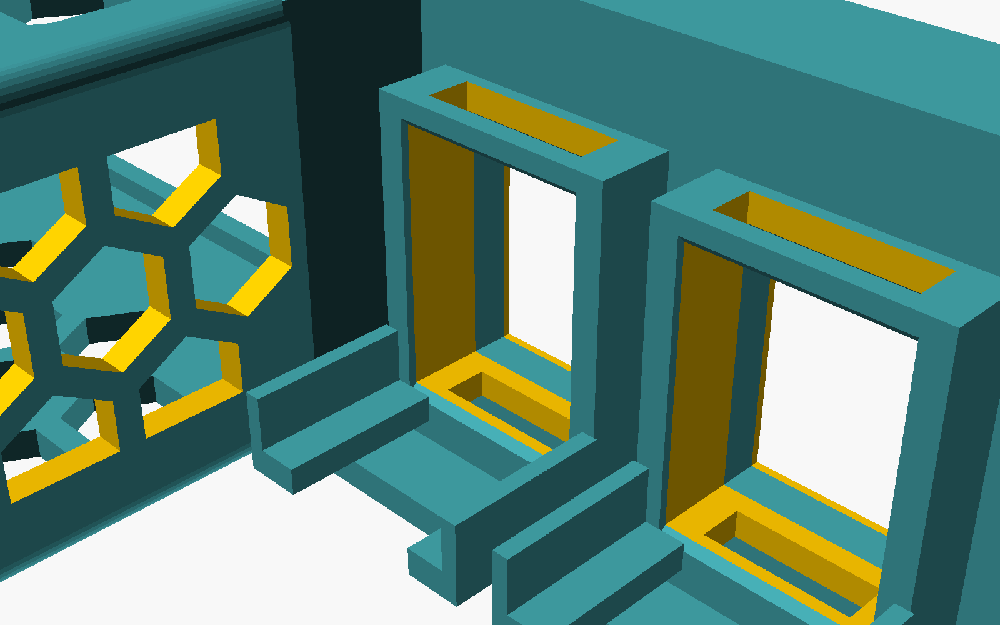
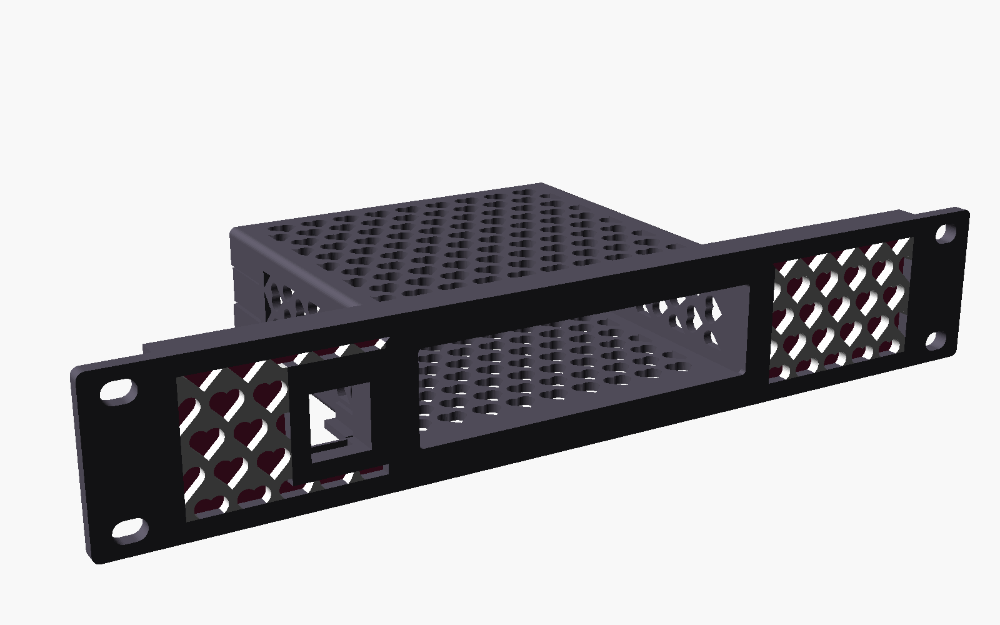
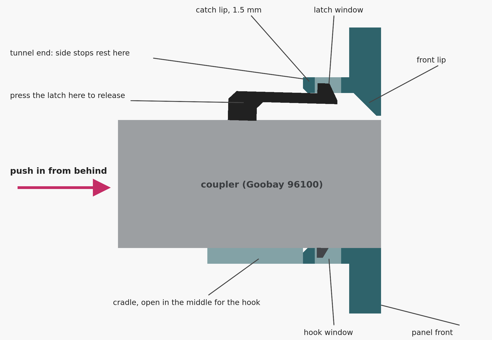
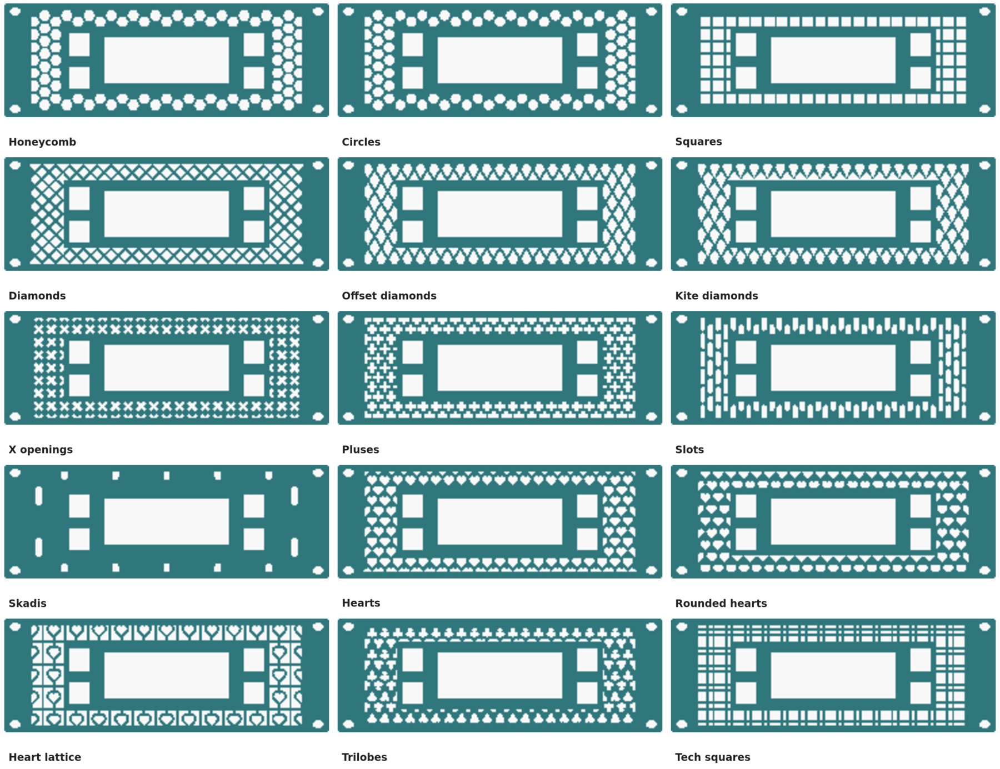
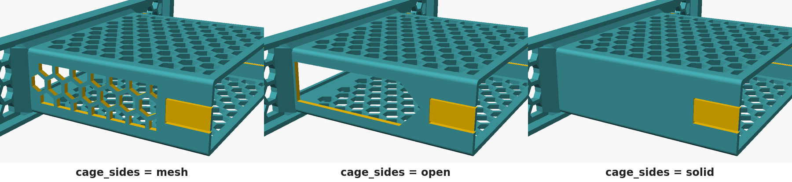

# parametric-switch-rack

A parametric 10-inch rack panel for a desktop network switch, with snap-in RJ45 keystone couplers beside it. Built for **KWS Rack V2**, works in any EIA-310 10" rack. One self-contained OpenSCAD file, made for **MakerWorld's Parametric Model Maker**.

## Five settings

The customizer opens with five groups. Most people never need anything else:

| | Setting | |
|---|---|---|
| 1 | **Panel size** | `rack_units`: 1U, 2U … 6U |
| 2 | **Switch size** | `switch_width`, `switch_height`, `switch_depth`, measured with calipers |
| 3 | **RJ45 couplers** | how many `keystones_left` / `keystones_right` (0 = none), and the coupler model (Goobay 96100 by default) |
| 4 | **Pattern** | one of 15 patterns, or solid |
| 5 | **What to print** | the full mount, or a test piece |

The ventilated enclosure around the switch (the "shelf all around") sizes itself from the switch dimensions, with 0.3 mm of clearance on every side. Its top, shelf and side walls are patterned. Everything else (clearances, retention style, coupler rows and placement, pattern details, rack fit, colours, split printing) is in the **Advanced** groups further down, with sensible defaults. When something doesn't fit, the model stops and tells you why and what to change. It never quietly shrinks an opening.

| | |
|---|---|
|  |  |
| Snap clips hold the switch from behind; patterned top, shelf and sides | 2U, 2×2 couplers each side, diamond pattern |
|  |  |
| Coupler holders from behind: tunnel, latch and hook windows, cradle | Multicolor: frame, pattern and backing colours |

## How the RJ45 couplers clip in

Keystone couplers like the Goobay 96100 and 90866 are made to clip into metal keystone holders (such as the Goobay 79883) **from behind**. Each coupler position on the panel copies that holder:

- **Tunnel:** 9.8 mm deep from the panel front. Inside it is the metal holder's 14.7 × 19.2 mm opening plus `keystone_tolerance` on every side: 15.0 × 19.5 mm for the 96100.
- **Windows and catch lip:** the latch wall and the hook wall each have a window. The coupler's spring latch (top) and fixed hook (bottom) drop into these windows. The back face of each then catches on the 1.5 mm lip behind its window. The datasheets put both catch faces 8.1 mm behind the coupler's front face, so the lip starts at 8.3 mm and the coupler face ends up flush with the panel.
- **Side stops:** the bumps (96100) or springs (90866) on the coupler's sides rest against the tunnel's rear end, so it can't slide forward.
- **Front lip:** at the face, the opening is only just taller than the coupler body, so it can't be pushed out through the front either.
- **Cradle:** behind the tunnel, two L-shaped rails carry the coupler body for another 12 mm. The gap between them lets the hook slide through to its window. The top stays open so you can reach the latch.

**To fit a coupler:** from behind the panel, push it in front first, latch on top, until it clicks. That's easiest before the panel goes into the rack. **To remove it:** press the latch down just behind the tunnel and lift the back of the coupler slightly so the hook clears its window. Then pull it out backwards.

Print the **keystone coupon** (`output = keystone_coupon`) first. It has three holders with the catch lip at **8.1 / 8.3 / 8.5 mm**, engraved on the back. Pick the depth where the coupler clicks in with the least play and set it as `keystone_catch_override`. A second coupon preset steps the tunnel tolerance instead, for a fit that is too tight or too loose.

Presets:

- `goobay_96100` (default, from the manufacturer drawing): body 14.5 × 16.1 mm, 33 mm long, catch 8.1 ± 0.1 mm, 16.5 mm wide over the side stops.
- `goobay_90866`: body 14.7 × 16.2 mm, 33.2 mm long, catch 8.1 ± 0.2 mm, EAN 4040849908668.
- `generic`: other modules made for the 19.2 × 14.9 keystone port. These are nominal values; check them with the coupon.
- `custom`: every dimension exposed.

Rows, spacing, latch direction, and placement next to the switch or out by the rack ears are under *Advanced: RJ45 couplers*. Unused holders take the snap-in blank covers from `output = accessories`. They push in from the front and click into the hook window.

## Patterns

These are the same 15 patterns as the KWS Customizable generators, plus solid: honeycomb, circles, squares, diamonds, offset diamonds, kite diamonds, X openings, pluses, slots, Skadis, hearts, rounded hearts, heart lattice, trilobes, tech squares. The KWS pattern controls carry over:

| KWS control | Here | Default |
|---|---|---|
| Opening_size | `opening_size` | 8 mm |
| Spacing | `pattern_spacing` | 2 mm (warns under 1.6) |
| Pattern_rotation | `pattern_rotation` | 0°, faceplate only |
| Pattern_area_percent | `pattern_area_percent` | 100 % |
| Slot_length_ratio | `slot_length_ratio` | 3 |
| Diamond_ratio | `diamond_ratio` | 1.7 |
| Heart_layout | `heart_layout` | nested |
| Skadis_scale | `skadis_scale` | 1 |
| Back_plate / Back_thickness | `back_plate` / `back_thickness` | off / 1 mm |
| Horizontal / Vertical / X supports, Rib_width | `horizontal_supports`, `vertical_supports`, `x_support`, `rib_width` | off |
| Multicolor, Frame / Pattern / Back colour | `multicolor`, `frame_color`, `pattern_color`, `back_color` | off, same colours |

KWS's *Original* pattern and the fan, insert and cable-routing options belong to the base deck, so they have no equivalent on a switch panel.

The pattern fills the faceplate around the switch and couplers, and the top, bottom and sides of the enclosure. Extra options here: clip cells at the borders or keep only whole cells; a symmetric, switch-centred or left-anchored layout; separate borders around the switch, the couplers and the panel edge. On the enclosure, which prints standing up, the openings stay self-supporting: honeycomb is flat-topped, circles become teardrops, slots get pointed tops, and rotation is not applied there.

**Multicolor:** download the result as **3MF** to keep the colours, then map them to filament slots in your slicer. The colour change only happens in the first few millimetres (the faceplate), so there is little purge waste. **Backing** closes the faceplate pattern from behind for a two-tone look. It blocks airflow through the faceplate; the enclosure still vents.

## Measuring your switch

| Parameter | Measure |
|---|---|
| `switch_width` | Across the front face, widest point |
| `switch_height` | Bottom of the rubber feet to the top. Or remove the feet and measure the body |
| `switch_depth` | Front face to rear face, ignoring connectors and cables |

The defaults (100 × 28 × 100) are placeholders. If the switch clearance ring (`output = switch_test`) is tight, raise `clearance_width` / `clearance_height`.

## Enclosure sides

Most small switches vent through their sides, so by default the enclosure's side walls carry the pattern too (`cage_sides = mesh`). For the most airflow, `open` cuts one large window into each side wall. Its rear end comes to a 45° point, so it still prints without supports. `solid` closes them.

Either way, the wall stays solid where it does a job: around the snap-clip tongues, under the crush ribs and at the screw bosses. It also stays solid along the edges and next to the panel. The border width is `cage_mesh_border` (4 mm by default).

## Holding the switch

| `switch_loading` | `retention` | How it works |
|---|---|---|
| `rear` (default) | `clips` (default) | Slides in from behind until its face hits the bezel lip. Two flexing tongues in the side walls snap in behind its rear face. To remove, pry them outward. Hook depth, length, height, thickness and ramp angle are adjustable. |
| `rear` | `screw` | Same bezel stop. Two small brackets screw onto bosses at the rear (M3: 2.5 mm pilot for self-tapping, 4.0 mm for heat-set inserts). |
| `rear` or `front` | `friction` | Crush ribs on the side walls. |
| `front` | `friction` + `rear_stop` | Slides in through the panel opening against a printed 45° backstop, like the common honeycomb switch mounts. |

## Rack: KWS Rack V2 / EIA-310 10"

KWS Rack V2 follows EIA-310 10". Panels bolt to M5 heat-set inserts in the front legs with **M5 × 10** screws; there are inserts at all three EIA positions in every U.

| Value | Default | Notes |
|---|---|---|
| Panel width | 254 mm | Fits the 256 mm X1C bed in one piece |
| Hole centres, left to right | 236.525 mm | EIA-310 10" |
| 1U | 44.45 mm | Panel = N × 44.45 − 0.8 mm gap |
| Hole positions per U | 6.35 / 22.225 / 38.1 mm | `ends` (default), `outer`, `center` or `all` |
| Hole | Ø 5.5 mm, 8 mm slot | Horizontal slot for alignment tolerance |
| Clear width between rails | 220 mm | **Measure your rack.** Nothing behind the panel may be wider |

The enclosure, gussets, bracket bosses and coupler holders are all checked against the rails and the panel height. The ear ribs and edge flanges stiffen the panel. They stay inside the rails and the panel's own height, so they never touch the rack or the next unit.

## Print the test pieces first

1. **Keystone coupon:** find the catch-lip depth where your coupler clicks in with the least play.
2. **Rack alignment frame** (`rack_test`): screw it to the rack to check hole spacing and rail clearance.
3. **Switch clearance ring** (`switch_test`): slide the switch in to check clearance and bezel overlap.
4. **Complete mount.**

## Printing (Bambu Lab X1 Carbon, PETG)

- **Orientation:** as exported, front face down on the plate. No supports anywhere. The enclosure, coupler holders and cradles stand up from the faceplate. The only overhangs are the 1.5 mm switch-clip hooks, the 45° chamfers, and short bridges (12.9 mm at most) over the coupler windows.
- **Bed:** a 254 mm panel uses almost the whole 256 mm plate. Centre it front to back (clear of the front-left first-layer-inspection zone) and skip the brim. On a smaller bed, `split_panel` cuts the panel into two halves with a glued dovetail joint.
- **Suggested profile:** 0.2 mm layers, 4 walls, 20–25 % gyroid infill, PETG, textured PEI. Check that the filament preset is PETG: MakerWorld downloads can arrive set to PLA.

## Testing on MakerWorld

You need a (free) Bambu Lab / MakerWorld account.

**Privately first: Parametric Model Maker editor**

1. Sign in and open [makerworld.com/makerlab/parametricModelMaker](https://makerworld.com/makerlab/parametricModelMaker).
2. Open the code editor and replace the sample with the full contents of `parametric_switch_rack.scad` (copy it from the raw file on GitHub). Nothing is published at this point.
3. The parameter panel builds itself from the file: the five basic groups first, then the *Advanced* groups. Change the switch size, coupler counts and pattern, and generate. The default renders in about 0.3 s locally, well inside MakerWorld's generation time limit.
4. If generation fails, open the log. The model's own messages (for example *"Use rack_units = 2"*) explain what doesn't fit.
5. Download the result as **3MF** (keeps multicolor) and open it in Bambu Studio to check the plate.

**Then publish**

6. Upload a new model and attach `parametric_switch_rack.scad` as a raw model file, alongside a 3MF from `exports/`.
7. MakerWorld validates the file ("Validating" → "Passed") and adds a **Customize** button. Open it and run through the five basic settings once more on the live listing.

**Locally:** OpenSCAD (a 2025+ snapshot is fastest; 2021.01 works too) → open the file → *Window → Customizer*. The example presets in `parametric_switch_rack.json` load automatically.

## Validation

The model stops with a message when:

- the enclosure is wider than the rails or taller than the panel (it suggests the rack-unit count that fits)
- a coupler holder sticks out past the rails or the panel height, or collides with the enclosure or a bracket boss
- the keystone catch lip is set so shallow that the latch window would run into the front lip
- the panel is wider than the bed without `split_panel`, or the mount is taller than the print height
- the bezel would close up, the switch is too shallow for the clip length, or the backing would leave less than 1 mm of pattern
- an impossible loading/retention combination is chosen, or the split line crosses the switch or a coupler
- a dropdown setting has a value the model doesn't know (instead of an unexplained empty result)

It warns (and still builds) about thin pattern walls, wide bezel lips, short screw engagement, stiff clips, friction-only retention, shortened gussets, backing and multicolor.

## Files

| File | |
|---|---|
| `parametric_switch_rack.scad` | The model: every parameter in the customizer, no external libraries |
| `parametric_switch_rack.json` | Example parameter sets: default 1U, front loading, screw brackets, 2U 4+4, multicolor hearts, both coupons, every test piece |
| `exports/` | Plain 3MF geometry of the default mount and the keystone coupon (no slicer profile) |
| `images/` | Renders used above |

Tested with OpenSCAD 2026.10 snapshots (Manifold backend: every configuration in the test matrix renders in under 1 s and passes a manifold check) and OpenSCAD 2021.01 (CGAL).

## Credits

- [KWS Rack V2](https://makerworld.com/en/models/2139130) by ilanKush: the rack this targets. The pattern set and its controls follow the KWS Customizable generator guide.
- The honeycomb-cage look of 10" switch mounts like [this USW-Lite-8 mount](https://makerworld.com/en/models/1400148). No geometry was copied; everything here is generated procedurally.

## License

MIT. See [LICENSE](LICENSE).
