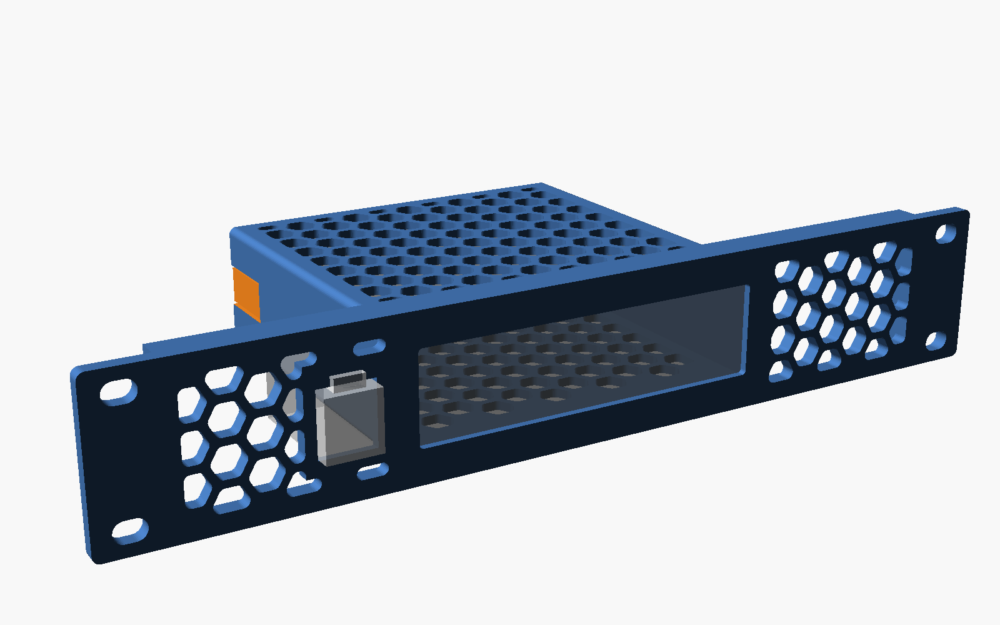
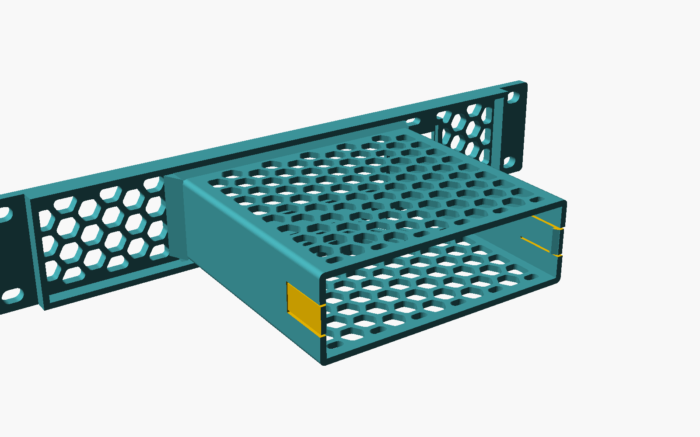
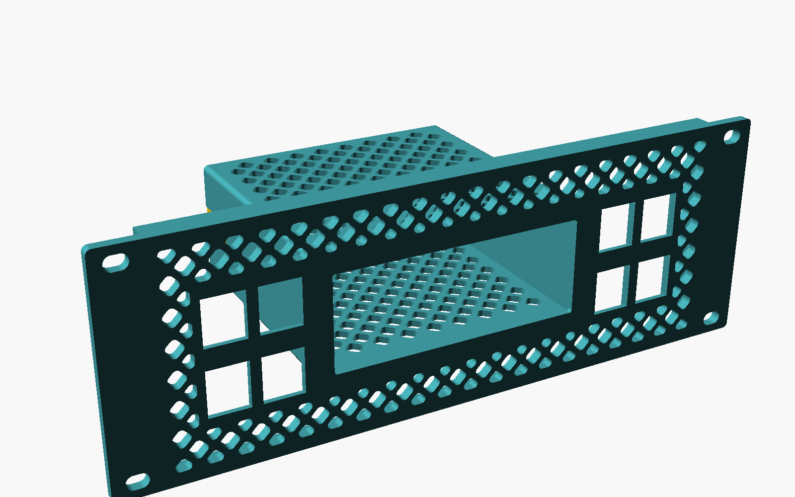
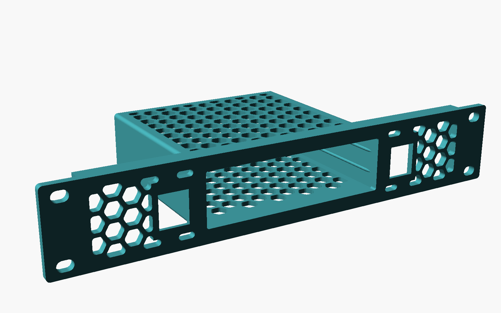
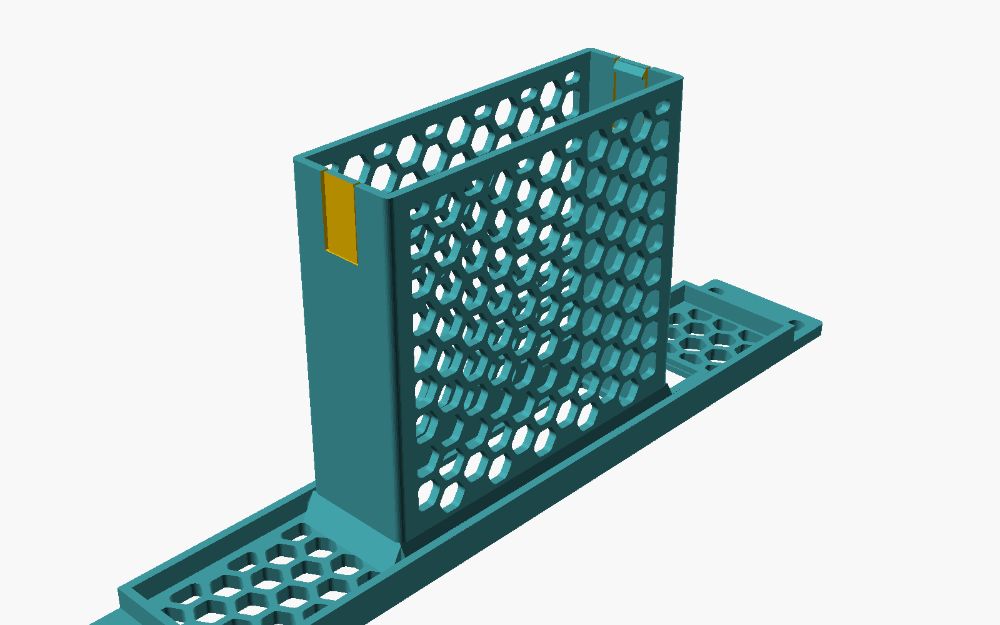
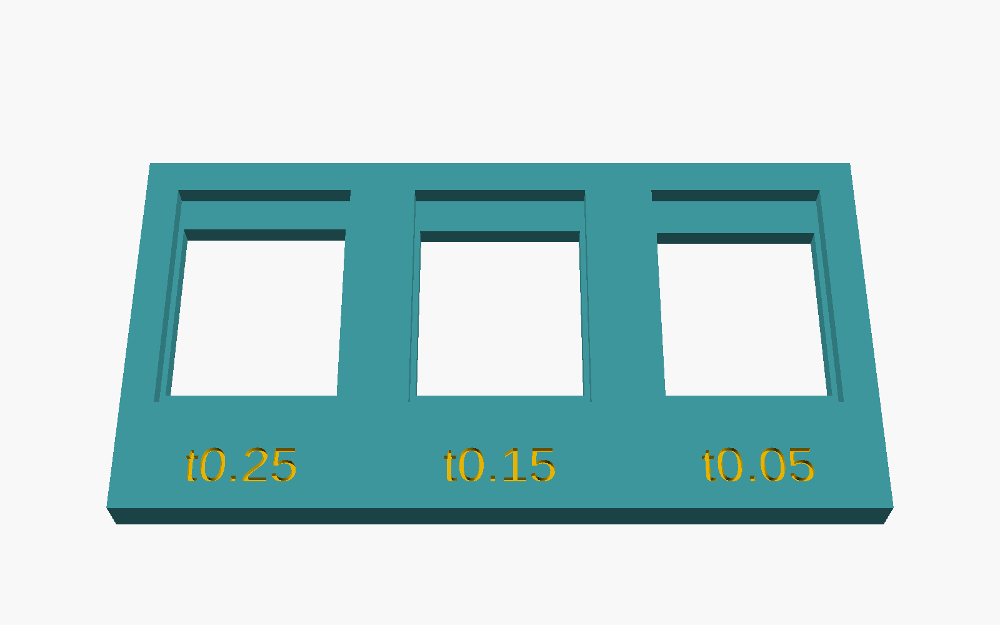

# parametric-switch-rack

A fully parametric 10-inch rack panel for a desktop network switch, with snap-in keystone couplers beside it. Built for **KWS Rack V2**, works in any EIA-310 10" rack. One self-contained OpenSCAD file, made for **MakerWorld's Parametric Model Maker**.

You enter your switch's measured size. The panel, the ventilated enclosure around the switch (the "shelf all around") and both meshes regenerate around it. Couplers are a separate count, so you can have 0–12 per side whatever the switch's port count. When something doesn't fit, the model stops and tells you why and what to change. It never quietly shrinks an opening.

| | |
|---|---|
|  |  |
| Snap clips at the rear, honeycomb top and shelf | 2U, 2×2 couplers each side, diamond mesh |
|  |  |
| Front-loading variant (slides in through the panel) | Prints face down, no supports |

## Print the test pieces first

Each one takes 10–30 minutes. Each catches a different mistake before you commit to a 4-hour panel.

1. **Keystone coupon** (`output = keystone_coupon`): three openings at fit tolerances 0.05 / 0.15 / 0.25 mm, engraved on the back. Or set `coupon_vary = plate` to step the latch plate thickness instead. Snap your coupler into each. Pick the one that locks firmly and still releases with the latch pressed. Put that value into `keystone_tolerance` (or `keystone_plate_override`).
2. **Rack alignment frame** (`output = rack_test`): the panel outline, mounting holes, ear ribs and flanges with the middle cut away. Screw it to the rack to check hole spacing and rail clearance.
3. **Switch clearance ring** (`output = switch_test`): the switch opening, bezel lip and a short slice of the enclosure. Slide the switch in to check the width/height clearance and that the bezel leaves ports and LEDs visible.
4. **Complete mount** (`output = mount`).

## Measuring your switch

All values are in millimetres, measured with calipers on the switch itself, not from a datasheet.

| Parameter | Measure |
|---|---|
| `switch_width` | Across the front face, widest point |
| `switch_height` | Bottom of the rubber feet to the top. Or remove the feet and measure the body |
| `switch_depth` | Front face to rear face, ignoring connectors and cables |

The defaults (100 × 28 × 100) are placeholders, not any particular model. Start with `clearance_width/height = 0.3` per side. Raise them if the clearance ring is tight. If you keep the rubber feet, the bezel overlaps less at the bottom.

## Rack: KWS Rack V2 / EIA-310 10"

KWS Rack V2 follows the EIA-310 10-inch standard. Panels bolt to M5 heat-set inserts in the front legs with **M5 × 10** screws. There are inserts at all three EIA positions in every U.

| Value | Default | Notes |
|---|---|---|
| Panel width | 254 mm | 10 in. Fits the 256 mm X1C bed in one piece |
| Hole centres, left to right | 236.525 mm | EIA-310 10" |
| 1U | 44.45 mm | Panel = N × 44.45 − 0.8 mm gap |
| Hole positions per U | 6.35 / 22.225 / 38.1 mm | Choose `ends`, `outer` (2 per U), `center` or `all` |
| Hole | Ø 5.5 mm, 8 mm slot | Horizontal slot for alignment tolerance |
| Clear width between rails | 220 mm | **Measure your rack.** Nothing behind the panel may be wider |

`panel_thickness` defaults to 4 mm, which leaves 6 mm of an M5 × 10 screw in the insert. Above 6 mm the model warns you to use M5 × 12.

Behind the panel, the enclosure, gussets, bracket bosses and coupler bodies are all checked against `rail_clear_width`. The coupler bodies and the top/bottom flanges are checked against the panel height. The ear ribs and edge flanges stiffen the panel. They sit inside the rails and inside the panel's own height, so they never touch the rack or the next unit.

## Keystone couplers

The default preset is the **Goobay 90866** Cat6A STP female-to-female keystone coupler (EAN 4040849908668). Dimensions are from the manufacturer's datasheet drawing:

| | Goobay 90866 |
|---|---|
| Keystone opening (nominal) | 14.9 × 17.0 mm |
| Body width | 14.7 ± 0.2 mm |
| Body height without latch | 16.2 ± 0.2 mm |
| Height including latch | 19.7 ± 0.2 mm |
| Overall length | 33.2 ± 0.2 mm |

"Keystone" is a de-facto standard. The roughly 14.9 mm wide snap-in format is shared across manufacturers, so any keystone module fits the same opening family. The **latch plate** varies from one manufacturer to the next: that's the thickness of material the spring latch clicks behind. So each opening has two layers:

- **Front: the latch plate.** The precise opening (nominal + `keystone_tolerance` on every side), as thick as the preset's latch plate (2.0 mm for the Goobay; change it with `keystone_plate_override`).
- **Behind it: a relief pocket** through the rest of the panel. It is wider than the opening, extends below it for the fixed hook and above it past the latch tip, so the coupler can tilt in and the latch can flex.

Presets: `goobay_90866` (from the datasheet), `generic_stp` and `generic_utp` (nominal values; verify them with the coupon), and `custom` (every dimension exposed). Orientation (latch up / down / left / right), rows, spacing, and placement next to the switch or out by the rack ears are all parameters. Unused openings take the snap-in blank covers from `output = accessories`.

## Holding the switch

| `switch_loading` | `retention` | How it works |
|---|---|---|
| `rear` (default) | `clips` (default) | Slides in from behind until its face hits the bezel lip. Two flexing tongues in the side walls snap in behind its rear face. To remove, pry the tongues outward. Hook depth, tongue length, height, thickness and ramp angle are adjustable. |
| `rear` | `screw` | Same bezel stop. Two small brackets screw onto bosses at the rear (M3: 2.5 mm pilot for self-tapping, 4.0 mm for heat-set inserts). Strongest. |
| `rear` or `front` | `friction` | Crush ribs on the side walls press into the switch. |
| `front` | `friction` + `rear_stop` | Slides in through the panel opening (like the common honeycomb switch mounts) against a printed 45° backstop. |

Front loading with snap clips, and rear loading with a fixed rear stop, are physically impossible, and the model rejects them with an explanation.

The enclosure is a full shelf with walls and a top by default. `cage_top`/`cage_bottom` can be reduced to lips or left open. `vent_standoff` raises the switch on ribs for airflow underneath. `gussets` brace the enclosure against the panel. `cage_depth = 0` sizes it to the switch automatically.

## Mesh

One pattern setting drives the faceplate and the enclosure: `hex`, `diamond`, `grid`, `round` or `solid`. Cell size, strut width, the extra margin from every border, and separate borders around the switch, the couplers and the panel edge are all adjustable. The layout can be symmetric about the panel centre, centred on the switch, or anchored left. Cells are either clipped at the borders (uniform border width; slivers too small to print are removed) or kept whole.

On the enclosure the openings are oriented for printing standing up. Honeycomb is flat-topped (short bridges only), diamonds have 45° tops, and round holes become teardrops.

## Printing (Bambu Lab X1 Carbon, PETG)

- **Orientation:** as exported, front face down on the plate. No supports anywhere. The only overhangs are the 1.5 mm clip hooks and the 45° chamfers under the bosses and the rear stop.
- **Bed:** a 254 mm panel uses almost all of the X1C's 256 mm. Centre it front to back so it stays clear of the front-left first-layer-inspection exclusion zone, and skip the brim. On a smaller bed, `split_panel` cuts the panel into two halves with a glued dovetail joint, positioned automatically in free space.
- **Suggested profile:** 0.2 mm layers, 4 walls, 20–25 % gyroid infill, PETG at the filament's normal temperature, textured PEI. Check that the filament preset is PETG: MakerWorld downloads can arrive set to PLA.
- **Checks:** the mesh struts must not drop below 1.2 mm (the model enforces this and warns under 1.6 mm). After slicing, check that the clip slits and keystone openings are open in every layer.

## Validation

The model stops with a message (OpenSCAD console / MakerWorld log) when:

- the enclosure is wider than the rails or taller than the panel (it suggests the rack-unit count that would fit)
- a coupler sticks out past the rails or the panel height, or collides with the enclosure or a bracket boss
- the panel is wider than the bed without `split_panel`, or the mount is taller than the print height
- the bezel would close up, the switch is too shallow for the chosen clip length, or the panel is thinner than the latch plate
- an impossible loading/retention combination is chosen, or the split line crosses the switch or a coupler

It warns (and still builds) about thin struts, wide bezel lips, short screw engagement, stiff clips, friction-only retention and shortened gussets.

## Uploading to MakerWorld

1. Open [Parametric Model Maker](https://makerworld.com/en/makerlab/parametricModelMaker) and load `parametric_switch_rack.scad`. Check that the switch, coupler and mesh controls regenerate the model. The default renders in about 0.3 s, well inside MakerWorld's generation time limit.
2. Publish it through MakerWorld's upload flow with the `.scad` attached. MakerWorld detects it and adds the Customize button. Add the images from `images/` and the exports from `exports/`.

## Files

| File | |
|---|---|
| `parametric_switch_rack.scad` | The model: every parameter in the customizer, no external libraries |
| `parametric_switch_rack.json` | Example parameter sets (OpenSCAD loads them automatically): default 1U, front loading, screw brackets, 2U 4+4, and every test piece |
| `exports/` | Plain 3MF geometry of the default mount and the keystone coupon. No slicer profile: choose PETG settings in your slicer |
| `images/` | Renders used above |

Tested with OpenSCAD 2026.10 snapshots (Manifold backend: every configuration renders in under 0.6 s and passes a manifold check) and OpenSCAD 2021.01 (CGAL: the full mount in about 40 s).

## Credits

- [KWS Rack V2](https://makerworld.com/en/models/2139130) by ilanKush: the rack this targets.
- The honeycomb-cage look of 10" switch mounts like [this USW-Lite-8 mount](https://makerworld.com/en/models/1400148). No geometry was copied; everything here is generated procedurally.

## License

MIT. See [LICENSE](LICENSE).
